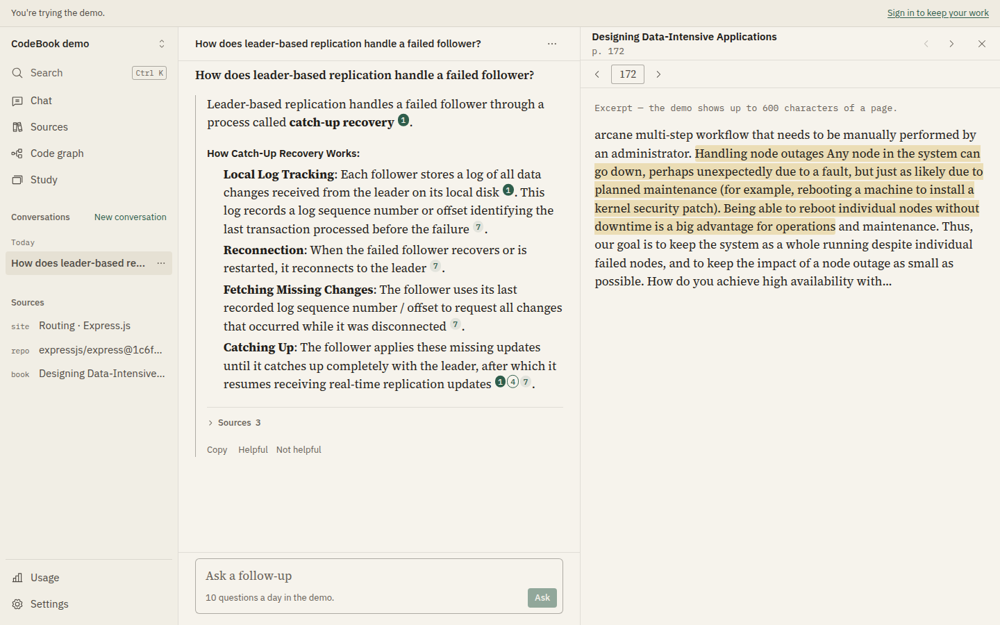
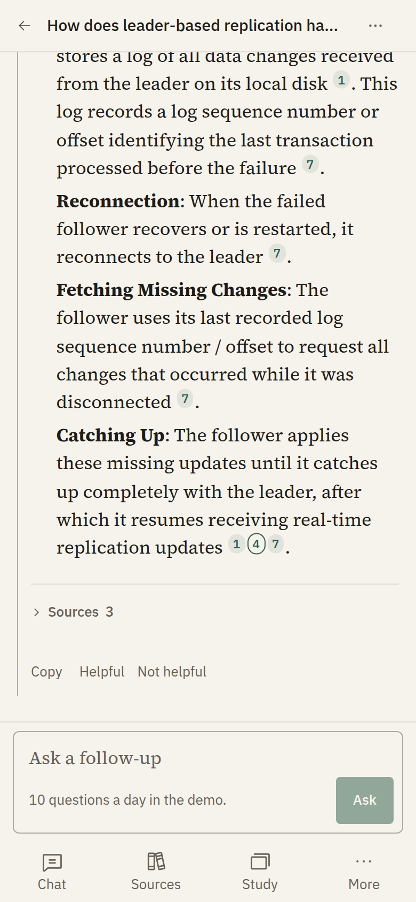
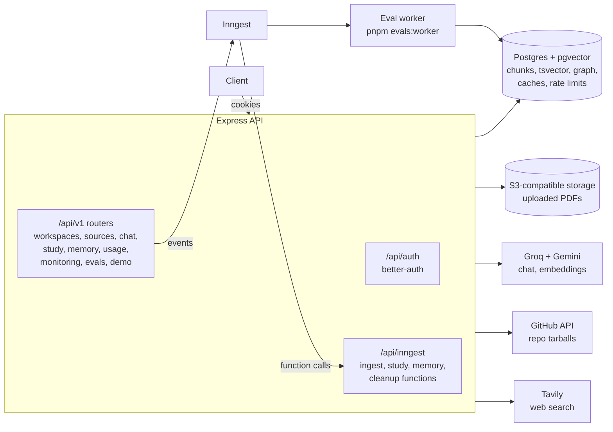
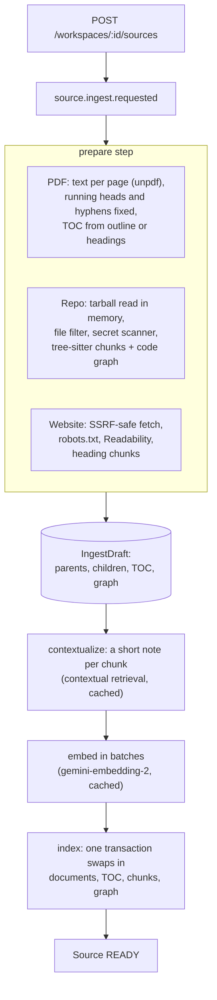
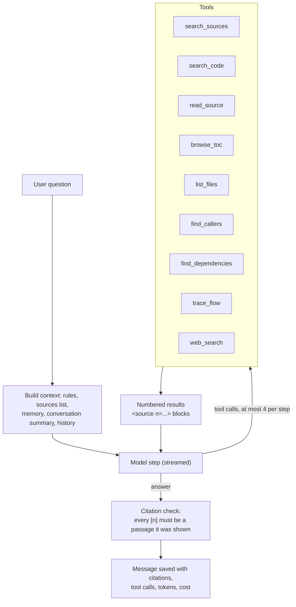

# CodeBook

A workspace that connects what's written about code (books, docs pages, specs) with the code
itself. You add a PDF, a public GitHub repository or a docs website to a workspace and ask
questions. An agent decides how to look for the answer — search by meaning and keywords, grep
the code, walk a book's table of contents, follow the call graph, or (as a last resort) search
the web — and answers with citations to the page, section or `file:line` it used.

An Express API with streaming chat, ingestion jobs and an eval suite, and a web app on top of
it (Vite and React, laid out for phones as well as desktops).





The screenshots are the public demo workspace: the book shows a short excerpt of the cited
page, never the PDF.

## Why

Learning a codebase usually means reading two things side by side: the prose that explains an
idea (a book chapter, a framework's guide) and the code that implements it. Plain RAG over one
vector index does badly at that. A question like "who calls `res.redirect`?" needs the call
graph, "what does chapter 7 say about write skew?" needs the book's structure, and "where is
the `ERR_HTTP_HEADERS_SENT` check?" needs exact text search. CodeBook gives the model all of
those as tools, lets it choose per question, and checks that its citations point at text it
was actually shown.

## What it does

- **Sources:** PDFs (text layer, page-accurate), public GitHub repositories at a pinned commit,
  and websites (polite crawl, robots.txt, one site at a time). Each is ingested in the
  background and indexed for hybrid search; repositories also get a code graph.
- **Chat:** an agent with nine tools streams its steps and answer over SSE. Every factual
  sentence cites a numbered passage; citations are checked against the passages before the
  answer is saved.
- **Study:** quizzes, flashcards, mind maps and summaries generated from a workspace's
  sources.
- **Memory:** the agent learns lasting facts about the user from conversations; it can be
  turned off per message, and every memory can be edited or deleted. Guests have none.
- **Evals:** a retrieval suite and an answer suite with LLM judges, ablation configs, and a CI
  gate that runs without API keys.
- **Limits and monitoring:** per-user rate limits and daily token budgets, a circuit breaker
  per model, usage per user, and admin-only monitoring of failed answers.
- **Demo:** a public read-only workspace that visitors can query as guests.

## Architecture



Each module under `backend/src/modules/` has the same shape: router → controller → service →
repository, with zod validators and DTOs. Long work (ingestion, study generation, memory
extraction, summaries, cleanup) runs as Inngest functions, so the API only queues it. Eval code
runs in its own Inngest app (`backend/evals/worker.ts`) and is never loaded by the API.

### Ingestion



Every step's output is cached (`ContextCache`, `EmbeddingCache`), so a retried step or a
resync only pays for what changed, and the old index stays searchable until the new one
commits. Chunks are parent/child: small children are searched, their parents are what the
model reads.

### The agent loop



A turn has at most 5 steps; the last one runs without tools so it has to answer. Each step's
input is trimmed to 12K tokens (old history first, then old tool results). Tool output and
everything else from the sources (and the user's memory) sits inside tagged blocks that the
prompt calls data, never instructions, and every tool re-checks that what it reads belongs to
the turn's workspace.

## Adaptive agentic RAG

The agent picks tools per question instead of running one fixed retrieve-then-answer pass:

| Tool | What it does | When the agent uses it |
|---|---|---|
| `search_sources` | Hybrid search (vector + keyword, fused with weighted RRF) over all sources | Concepts and explanations; if results come back weak, it rephrases or tries another tool |
| `search_code` | Exact text or regex over the repositories' files (time-limited, length-capped pattern) | Identifiers, error messages, config keys |
| `read_source` | Exact text: file lines, book pages, a whole TOC section | Reading around a hit, or a section found with `browse_toc` |
| `browse_toc` | A book's table of contents, two levels at a time, with page ranges | Questions about a chapter or section |
| `list_files` | Files of a repository (or pages of a site) with language and size | Seeing how a repository is laid out before reading |
| `find_callers` | Who calls a function, through several hops | "Where is X used", impact questions |
| `find_dependencies` | What a function, class or file calls and imports | "What does X use" |
| `trace_flow` | Shortest call chain between two functions | "How does a request reach the database" |
| `web_search` | Tavily web search; results are marked external | Only when the sources don't cover it, or for current facts (never for guests) |

Search details: vector search on an HNSW index (`ef_search` 80), keyword search on a
`tsvector` OR-query, keyword list weighted ¼ in the fusion, optional MiniLM cross-encoder
reranking (off by default, see the eval notes), optional query rewrite, HyDE or decomposition,
and a "weak results" flag when the best vector match is under 0.65.

Model routing (free tiers): the agent runs on Gemini Flash (`gemini-3.6-flash`) and falls back
to Groq's `gpt-oss-120b`; bulk work (contextual notes, summaries) uses Gemini Flash-Lite;
cheap tasks (titles, query rewrites, memory extraction) use `gpt-oss-20b`; embeddings are
`gemini-embedding-2`. Each call records a `UsageEvent` with tokens and cost. An optional second
Gemini key (`GEMINI_API_KEY_2`, from another Google project) is tried before the next model and
doubles the contextualizing rate, and when a question can't be embedded, search falls back to
keyword matches and says so.

## Eval results

### Retrieval

Dataset `core` (65 hand-checked cases, answers paraphrased: 51 DEV, 14 HELDOUT) over this
corpus:

- **Book:** *Designing Data-Intensive Applications* (Kleppmann), 491 pages → 266 parent /
  924 child chunks, 187 TOC entries. The PDF is copyrighted and not in this repository.
- **Repository:** `expressjs/express` at commit `1c6f1b0fe4000977b9a7b4f34097e4d527dd9824`
  → 100 files, 212 child chunks, 155 symbols, 870 graph edges.
- **Docs page:** the Express routing guide, `https://expressjs.com/en/guide/routing.html`
  (one page, 19 child chunks).

Measured 2026-10-24 on the DEV split (46 cases at the time: 42 answerable, 4 with no answer).
Full notes in [backend/evals/CHANGELOG.md](backend/evals/CHANGELOG.md).

| Config | Recall@5 | Recall@10 | MRR |
|---|---|---|---|
| vector only | 0.925 | 0.960 | 0.946 |
| keyword only | 0.714 | 0.778 | 0.556 |
| hybrid, keyword weight 1 | 0.897 | 0.929 | 0.822 |
| **hybrid, keyword weight ¼ (default)** | 0.901 | 0.937 | 0.885 |
| hybrid ¼ + MiniLM rerank | 0.917 | 0.984 | 0.839 |
| hybrid ¼ + rerank + rewrite | 0.917 | 0.984 | 0.827 |
| hybrid ¼ + rerank + HyDE | 0.893 | 0.960 | 0.832 |
| hybrid ¼ + rerank + decompose | 0.925 | 0.984 | 0.835 |

- **Contextual retrieval** (a model-written note prepended to each chunk before embedding), on
  the 19 code and cross-source cases: recall@5 0.921 with the notes vs 0.816 without (recall@10
  1.000 vs 0.947, MRR 0.723 vs 0.673).
- **HELDOUT** (14 cases, looked at once after the DEV decisions): vector only 0.974 / 1.000 /
  0.885, hybrid + rerank 0.897 / 1.000 / 0.748.
- The MiniLM reranker lifts the book's results (it was trained on web passages, not code) and
  takes ~2 s of CPU per search, so it is opt-in. Hybrid is the default because the keyword list
  catches exact identifiers.
- **CI gate** (repository + docs page only, 28 gate cases, hybrid without reranker):
  recall@5 0.819, recall@10 0.931, MRR 0.881, recorded 2026-10-25 in
  [backend/evals/baseline.json](backend/evals/baseline.json).

### Answers

The answer suite runs the real chat turn with a pinned model and no web search, then judges
correctness, faithfulness and citation precision/recall with LLM judges (Gemini Flash-Lite,
cached), plus trajectory metrics (expected tool used, steps, redundant calls). The configs are
in `backend/evals/configs/answer/`:

| Config | Compares |
|---|---|
| `static-rag` vs `adaptive-agent` | one search then answer, vs the agent loop |
| `adaptive-no-graph`, `adaptive-no-toc`, `vectorless-only` | tool ablations |
| `long-context` | the sources stuffed into the prompt instead of retrieval |
| `model-gemini-flash-6k5`, `model-gpt-oss-120b-6k5`, `model-gpt-oss-20b-6k5` | models at one 6.5K-token budget |
| `memory-on` vs `memory-off` | personal cases with seeded memories |
| `prompt-v2`, `prompt-v3` | the previous default prompt, and a prompt experiment, against `agent-system@v4` |

## More

Security checks and their evidence are written up in [docs/security.md](docs/security.md),
query plans and tuning in [docs/performance.md](docs/performance.md).

## Local setup

Needs Node 22+, pnpm 12 (`corepack enable` picks the pinned version) and Docker.

### Accounts and keys

All have free tiers. Put the values in `backend/.env` (copied from `backend/.env.example`);
never commit it.

| Variable | Where it comes from | Needed for |
|---|---|---|
| `BETTER_AUTH_SECRET` | `openssl rand -base64 32` (32+ characters) | always |
| `GEMINI_API_KEY` | Google AI Studio | chat, embeddings, ingestion |
| `GEMINI_API_KEY_2` | a second Google AI Studio project (optional; quotas are per project) | used when the first key's quota runs out |
| `GROQ_API_KEY` | console.groq.com | chat fallback, cheap tasks |
| `GITHUB_TOKEN` | GitHub fine-grained token, public repositories, read-only | repository sources |
| `TAVILY_API_KEY` | tavily.com | the `web_search` tool |
| `GITHUB_CLIENT_ID`, `GITHUB_CLIENT_SECRET` | GitHub OAuth app, callback `http://localhost:4000/api/auth/callback/github` | optional GitHub login (both or neither) |
| `ADMIN_USER_IDS` | comma-separated user ids | `/api/v1/monitoring` and `/api/v1/evals` |

The rest of `.env.example` (ports, database URLs, storage settings, `INNGEST_DEV`,
`INNGEST_BASE_URL`, `EVALS_WORKER_PORT`, reranker model and cache dir, `LOG_LEVEL`,
`LOG_TO_FILE`, `TRUST_PROXY`, `TRUSTED_ORIGINS`) works as is for local development. In
production `INNGEST_EVENT_KEY` and `INNGEST_SIGNING_KEY` are required and `INNGEST_DEV` must
not be set.

### Run it

```bash
cd backend
cp .env.example .env              # then fill in the keys above
docker compose up -d              # postgres + pgvector, S3 storage (SeaweedFS, + bucket setup), inngest dev server
pnpm install
pnpm db:migrate                   # apply migrations and generate the Prisma client
pnpm dev                          # API on http://localhost:4000
```

| Service | URL |
|---|---|
| API | http://localhost:4000 (readiness: `/api/v1/health/ready`) |
| API docs | http://localhost:4000/docs, spec at `/openapi.json` |
| Inngest dev UI | http://localhost:8288 |
| S3 API | http://localhost:9010 (any keys; buckets `codebook` and `codebook-test`) |
| Postgres | localhost:5436 (codebook / codebook) |

The Inngest dev server calls the API at `/api/inngest` (and the eval worker on port 4001 while
it runs), so ingestion only progresses with both `pnpm dev` and the compose stack up. The first
reranked search downloads the MiniLM model (~23 MB) into `backend/.cache/models`.

### Web app

```bash
cd frontend
pnpm install
pnpm dev                          # http://localhost:3000, proxies /api to the API on :4000
```

With the API started as `LLM_MOCK=1 pnpm dev`, scripted models stand in for Groq and Gemini, so
the whole app can be clicked through with no keys and no quota (the mock is refused when
`NODE_ENV=production`). Scripts, budgets and folders are in [`frontend/README.md`](frontend/README.md).

### Demo workspace

```bash
pnpm evals:cache -- import       # fresh clone: load the committed cache file first
pnpm db:seed -- --demo            # with pnpm dev and the Inngest dev server running
```

The seed creates the demo owner (a system user that never signs in) and the public demo
workspace, then adds the corpus sources through the normal ingestion pipeline. Every context
and embedding has to come from the caches: the seed stops with an error as soon as the ingest
calls a model, unless you pass `--allow-model-calls`. `pnpm evals:cache -- import` loads the
cache for the repository and the docs page. The book is optional and is added only when an
indexed copy with the same title already exists: put your own DDIA PDF at
`backend/evals/corpus/ddia.pdf` and index it once with `pnpm evals:corpus`. Otherwise the seed
skips it with a message, and the demo has the express repository and the routing docs page.
Running the seed again only adds what is missing and resyncs failed sources.

Guests get a session from `POST /api/auth/sign-in/anonymous`, can read the demo workspace's
sources and ask questions in it (10 messages a day per IP), and can't create workspaces or
sources, use study tools or memory. Guest accounts and their conversations are deleted after 7
days. New guest sessions are limited to 5 a day per IP. Repeat first questions to the demo
within 24 hours are answered from a cache, without model calls.

### Tests and checks

```bash
pnpm format:check && pnpm lint && pnpm typecheck && pnpm test
```

Tests run against the `codebook_test` database (created by `docker/postgres-init.sql`) with
mocked model calls, one file at a time. Tests that call real providers are skipped unless
`LIVE_TESTS=1`. CI (`.github/workflows/ci.yml`) runs the same checks plus `pnpm build`.

### Evals

```bash
pnpm evals:import                                   # load evals/datasets/core.json into the database
pnpm evals:corpus                                   # build the eval workspace (needs pnpm dev + Inngest)
pnpm evals -- --suite retrieval --config hybrid     # one config; --matrix all for every config
pnpm evals:report                                   # markdown report into backend/evals/reports/
```

The full corpus needs the DDIA PDF in `backend/evals/corpus/`. Answer-suite runs go through the
eval worker: `pnpm evals:worker` (port 4001), then `POST /api/v1/evals/runs` as an admin, or
`pnpm evals -- --suite answer --config adaptive-agent --limit 10` from the CLI. Both spend
free-tier model quota.

**CI gate** (`.github/workflows/evals.yml`, on every PR touching `backend/src` or
`backend/evals`): builds the gate corpus (repository + docs page) from the committed cache file,
runs the gate cases and fails when recall@5, recall@10 or MRR drop more than 0.03 below
`evals/baseline.json`. It needs no API keys. To run it locally:

```bash
pnpm evals:import
pnpm evals:cache -- import                          # load evals/cache/gate-cache.jsonl.gz
pnpm evals:corpus -- --variant gate --require-cached
pnpm evals:gate
```

After a change that should move the numbers: `pnpm evals:baseline` and
`pnpm evals:cache -- export`, and commit both files.

## API overview

All routes are under `/api/v1` and need a session cookie unless noted. Responses are
`{ success, message, data }`; errors carry a `code` and the request's `correlationId`.
Writes from a browser must come from a trusted origin. The full spec, with request and response
schemas and the SSE event types, is at [`/docs`](http://localhost:4000/docs) when the server
runs; the raw spec is at `/openapi.json`.

| Area | Routes |
|---|---|
| Auth (better-auth) | `/api/auth/sign-up/email`, `/api/auth/sign-in/email`, `/api/auth/sign-out`, `/api/auth/get-session`, `/api/auth/sign-in/social` (GitHub), `/api/auth/sign-in/anonymous` (guests) · `GET /me` |
| Health (public) | `GET /health/live`, `GET /health/ready` |
| Demo (public) | `GET /demo`: the demo workspace and its sources (404 until the seed has run) |
| Workspaces | `GET/POST /workspaces`, `GET/PATCH/DELETE /workspaces/:workspaceId`, `POST /workspaces/:workspaceId/search` (debug search) |
| Sources | `GET/POST /workspaces/:workspaceId/sources` (PDF upload as multipart, repo or website as JSON), `GET/DELETE /sources/:sourceId`, `POST /sources/:sourceId/resync`, `GET /sources/:sourceId/events` (SSE ingest progress), `GET /sources/:sourceId/toc`, `/files`, `/content` |
| Code graph | `GET /sources/:sourceId/graph/symbols`, `/callers`, `/dependencies`, `/path` |
| Chat | `GET/POST /workspaces/:workspaceId/conversations`, `GET/PATCH/DELETE /conversations/:conversationId`, `POST /conversations/:conversationId/messages` (SSE: `step`, `token`, `citations`, `done`, `error`), `POST /messages/:messageId/feedback` |
| Study | `GET/POST /workspaces/:workspaceId/study` (`QUIZ`, `FLASHCARDS`, `MINDMAP`, `SUMMARY`), `GET/DELETE /study/:studyId`, `POST /study/:studyId/regenerate` |
| Memory | `GET/POST/DELETE /memories`, `PATCH/DELETE /memories/:memoryId`, `POST /memories/:memoryId/restore` |
| Usage | `GET /usage/me`: tokens and cost today and over 7 and 30 days, and the limits left |
| Monitoring (admin) | `GET /monitoring/stats`, `GET /monitoring/failed-queries` |
| Evals (admin) | `GET /evals/datasets`, `GET/POST /evals/runs`, `GET /evals/runs/:runId`, `GET /evals/runs/:runId/results`, `GET /evals/compare` |

Admin routes answer 404 to everyone not in `ADMIN_USER_IDS`. `backend/http/` has ready-made
requests for most modules (REST Client format).
