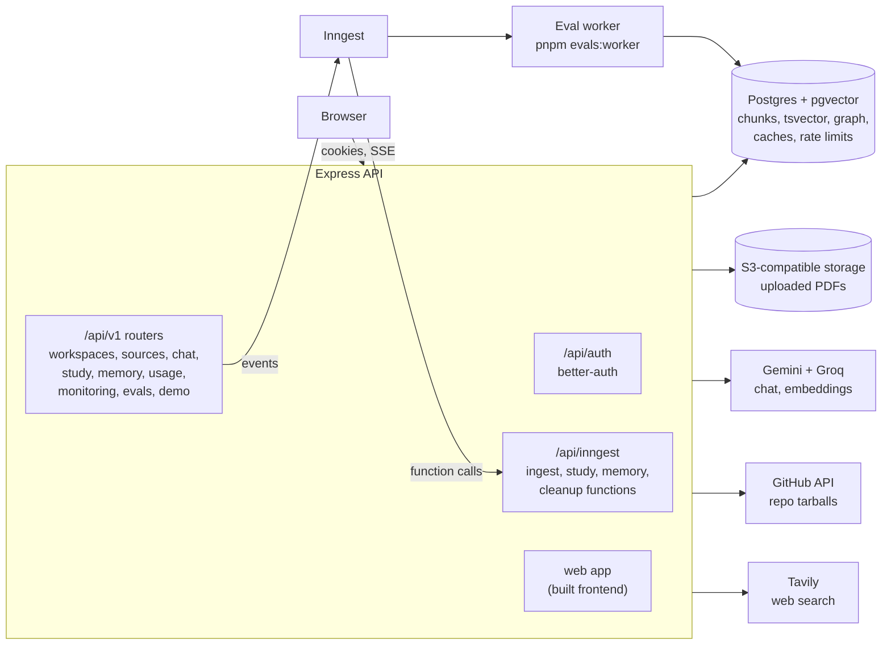
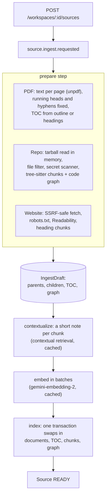
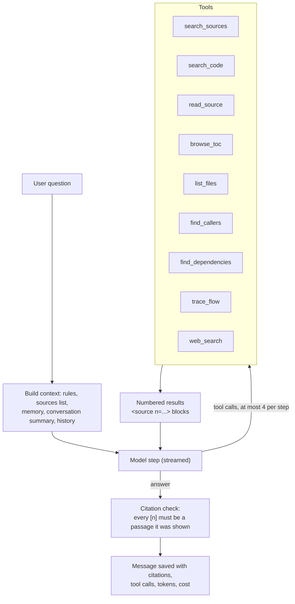

<div align="center">
  <h1>CodeBook</h1>
  <p><strong>Ask a book and its code together.</strong><br/>
  An agentic RAG workspace for books, docs and repositories, with answers cited to the page, section or line.</p>

  <p>
    <a href="https://codebook.girishthedecent.space"><strong>Live demo</strong></a> ·
    <a href="#how-it-works">How it works</a> ·
    <a href="#evaluation">Evaluation</a> ·
    <a href="#getting-started">Getting started</a> ·
    <a href="#api">API</a>
  </p>

  [](https://github.com/girishthedecent/codebook/actions/workflows/ci.yml)
  [](https://github.com/girishthedecent/codebook/actions/workflows/frontend.yml)
  [](https://github.com/girishthedecent/codebook/actions/workflows/evals.yml)

  
  
  
  
  
  
  
  
  
  
</div>

---

Learning a codebase usually means reading two things side by side: the prose that explains an
idea (a book chapter, a framework's guide) and the code that implements it. CodeBook puts both
in one workspace. Add a PDF, a public GitHub repository or a docs site, then ask questions. An
agent decides how to look for each answer, and every claim in the answer points at the page,
section or `file:line` it came from, which opens beside the chat.

The [live demo](https://codebook.girishthedecent.space) needs no account. It holds *The Little
Book of Deep Learning*, Andrej Karpathy's nanoGPT and Hugging Face's text generation guide, and
asks how a GPT works.

## Contents

- [Why an agent](#why-an-agent)
- [Features](#features)
- [How it works](#how-it-works)
- [Evaluation](#evaluation)
- [Tech stack](#tech-stack)
- [Getting started](#getting-started)
- [Testing and evals](#testing-and-evals)
- [Deploying](#deploying)
- [API](#api)
- [Project layout](#project-layout)
- [Credits](#credits)

## Why an agent

Plain RAG over one vector index does badly with this kind of material, because different
questions need different ways of looking:

| Question | What it needs |
|---|---|
| "Who calls `CausalSelfAttention.forward`?" | the call graph |
| "What does the chapter on architectures say about attention?" | the book's structure |
| "Where is `scaled_dot_product_attention` used?" | exact text search |
| "How does attention in the book map onto nanoGPT?" | search across sources, then reading both |

CodeBook gives the model each of these as a tool, lets it choose per question, retries when the
first results are weak, and checks before saving that every citation points at text the model
was actually shown.

## Features

**Sources.** PDFs with page-accurate text and a table of contents, public GitHub repositories at
a pinned commit with a code graph (TypeScript, JavaScript, Python), and docs sites crawled
politely (robots.txt, one site at a time). Ingestion runs in the background with live progress,
and a source stays searchable while it re-indexes.

**Chat.** A tool-using agent streams its steps and its answer. Answers read like a page with
footnotes: numbered notes under the answer (in the margin on wide screens) open the cited book
page, code lines or docs section in a resizable viewer. A failed answer can be retried in place,
and a stopped one keeps what it had written.

**Code graph.** An overview of the repository, then any symbol's callers and calls, the path
between two functions, and the library calls a symbol makes.

**Study.** Quizzes, flashcards, mind maps and summaries generated from a whole workspace, one
book chapter or one repository folder, with the same citations as answers.

**Memory.** The agent keeps lasting facts about you from conversations. It can be turned off per
question, and every memory can be edited or deleted.

**Search.** Ctrl K finds sources, conversations and passages; a search panel shows ranked
passages with the matching terms marked.

**Demo and guests.** A public read-only workspace with starter questions and ready-made study
sets. Guests need no account and get 10 questions a day.

**Limits and monitoring.** Per-user rate limits and daily token budgets, a circuit breaker per
model, 14 days of usage per user, and admin pages for failed answers, model and key usage,
ingestion failures, rate-limit hits, circuit-breaker state and eval runs.

**Web app.** An editorial reading interface in light and dark, laid out for phones (bottom tabs,
the viewer as a sheet) as well as desktops, keyboard-friendly, and under 150 KB of JavaScript on
first load.

## How it works



One service serves both the API and the web app, so the browser talks to a single origin: the
session cookie stays first-party and answers stream as they are written. Each module under
`backend/src/modules/` has the same shape (router, controller, service, repository, with zod
validators and DTOs). Long work runs as Inngest functions, so requests only queue it. Eval code
runs in its own Inngest app (`backend/evals/worker.ts`) and is never loaded by the API.

### Ingestion



Every step's output is cached (`ContextCache`, `EmbeddingCache`), so a retried step or a resync
only pays for what changed, and the old index stays searchable until the new one commits.
Chunks are parent/child: small children are searched, and their parents are what the model
reads.

### The agent loop



A turn has at most 5 steps; the last runs without tools so it has to answer. Each step's input
is trimmed to 12K tokens (old history first, then old tool results). Tool output, source text
and the user's memory sit inside tagged blocks that the prompt treats as data, never
instructions, and every tool re-checks that what it reads belongs to the turn's workspace.

| Tool | What it does | When the agent uses it |
|---|---|---|
| `search_sources` | Hybrid search (vector + keyword, fused with weighted RRF) over all sources | Concepts and explanations; on weak results it rephrases or tries another tool |
| `search_code` | Exact text or regex over the repositories' files (time-limited, length-capped pattern) | Identifiers, error messages, config keys |
| `read_source` | Exact text: file lines, book pages, a whole TOC section | Reading around a hit, or a section found with `browse_toc` |
| `browse_toc` | A book's table of contents, two levels at a time, with page ranges | Questions about a chapter or section |
| `list_files` | A repository's files (or a site's pages) with language and size | Seeing how a repository is laid out before reading |
| `find_callers` | Who calls a function, through several hops | "Where is X used", impact questions |
| `find_dependencies` | What a function, class or file calls and imports | "What does X use" |
| `trace_flow` | The shortest call chain between two functions | "How does a request reach the database" |
| `web_search` | Tavily web search; results are marked external | Only when the sources don't cover it, or for current facts (never for guests) |

**Search.** Vector search on an HNSW index (`ef_search` 80), keyword search on a `tsvector`
OR-query weighted ¼ in the fusion, optional MiniLM cross-encoder reranking (off by default, see
[Evaluation](#evaluation)), optional query rewrite, HyDE or decomposition, and a "weak results"
flag when the best vector match is under 0.65.

**Models.** All on free tiers. The agent runs on Gemini Flash (`gemini-3.6-flash`) and falls
back to Groq's `gpt-oss-120b`; bulk work (contextual notes, summaries) uses Gemini Flash-Lite;
cheap tasks (titles, query rewrites, memory extraction) use `gpt-oss-20b`; embeddings are
`gemini-embedding-2`. Every call records its tokens and cost. An optional second Gemini key from
another Google project is tried before the next model, and when a question can't be embedded,
search falls back to keyword matches and says so.

**Reliability.** A model that keeps hitting its quota is skipped for a while (a circuit breaker
per model and key), a retried answer replaces the failed attempt, a guest whose answer failed
because the models were out of quota gets the question back, and repeat first questions to the
demo are answered from a 24-hour cache without model calls.

## Evaluation

### Retrieval

Dataset `core`: 65 hand-checked cases with paraphrased answers (51 DEV, 14 HELDOUT), over a
corpus separate from the demo:

- **Book:** *Designing Data-Intensive Applications* (Kleppmann), 491 pages, 266 parent and
  924 child chunks, 187 TOC entries. The PDF is copyrighted and not in this repository.
- **Repository:** `expressjs/express` at commit `1c6f1b0fe4000977b9a7b4f34097e4d527dd9824`:
  100 files, 212 child chunks, 155 symbols, 870 graph edges.
- **Docs page:** the Express routing guide, `https://expressjs.com/en/guide/routing.html` (one
  page, 19 child chunks).

Measured 2026-10-24 on the DEV split (46 cases at the time: 42 answerable, 4 with no answer).
Full notes are in [backend/evals/CHANGELOG.md](backend/evals/CHANGELOG.md).

| Config | Recall@5 | Recall@10 | MRR |
|---|---|---|---|
| vector only | 0.925 | 0.960 | 0.946 |
| keyword only | 0.714 | 0.778 | 0.556 |
| hybrid, keyword weight 1 | 0.897 | 0.929 | 0.822 |
| **hybrid, keyword weight ¼ (default)** | 0.901 | 0.937 | 0.885 |
| hybrid ¼ + MiniLM rerank | 0.917 | 0.984 | 0.839 |
| hybrid ¼ + rerank + rewrite | 0.917 | 0.984 | 0.827 |
| hybrid ¼ + rerank + HyDE | 0.893 | 0.960 | 0.832 |
| hybrid ¼ + rerank + decompose | 0.925 | 0.984 | 0.835 |

- **Contextual retrieval** (a model-written note prepended to each chunk before embedding), on
  the 19 code and cross-source cases: recall@5 0.921 with the notes against 0.816 without
  (recall@10 1.000 against 0.947, MRR 0.723 against 0.673).
- **HELDOUT** (14 cases, looked at once, after the DEV decisions): vector only 0.974 / 1.000 /
  0.885, hybrid + rerank 0.897 / 1.000 / 0.748.
- The MiniLM reranker lifts the book's results (it was trained on web passages, not code) and
  costs about 2 s of CPU per search, so it is opt-in. Hybrid is the default because the keyword
  list catches exact identifiers.
- **CI gate** (repository and docs page only, 28 gate cases, hybrid without reranker): recall@5
  0.819, recall@10 0.931, MRR 0.881, recorded 2026-10-25 in
  [backend/evals/baseline.json](backend/evals/baseline.json).

### Answers

The answer suite runs the real chat turn with a pinned model and no web search, then judges
correctness, faithfulness and citation precision and recall with LLM judges (Gemini Flash-Lite,
cached), plus trajectory metrics (expected tool used, steps, redundant calls). The configs are
in `backend/evals/configs/answer/`:

| Config | Compares |
|---|---|
| `static-rag` vs `adaptive-agent` | one search then answer, against the agent loop |
| `adaptive-no-graph`, `adaptive-no-toc`, `vectorless-only` | tool ablations |
| `long-context` | the sources stuffed into the prompt instead of retrieval |
| `model-gemini-flash-6k5`, `model-gpt-oss-120b-6k5`, `model-gpt-oss-20b-6k5` | models at one 6.5K-token budget |
| `memory-on` vs `memory-off` | personal cases with seeded memories |
| `prompt-v2`, `prompt-v3` | the previous default prompt, and a prompt experiment, against `agent-system@v4` |

## Tech stack

| | |
|---|---|
| **API** | Node 22, Express 5, TypeScript, zod, OpenAPI docs generated from the zod schemas |
| **Data** | Postgres with pgvector (Prisma 7), S3-compatible storage for PDFs |
| **AI** | Vercel AI SDK with Gemini and Groq, Tavily for web search, a local MiniLM reranker |
| **Parsing** | unpdf, tree-sitter, Readability |
| **Jobs** | Inngest |
| **Auth** | better-auth: email and password, guests, optional GitHub |
| **Web app** | React 19, Vite, TanStack Router and Query, Tailwind, Radix, pdf.js, Shiki, React Flow |
| **Tests** | Vitest and Supertest, plus the eval suites |
| **Deploy** | Render (one service), Supabase Postgres and Storage, Inngest Cloud |

## Getting started

Needs Node 22+, pnpm 12 (`corepack enable` picks the pinned version) and Docker.

### 1. Keys

All have free tiers. Put the values in `backend/.env`, copied from `backend/.env.example`, and
never commit it.

| Variable | Where it comes from | Needed for |
|---|---|---|
| `BETTER_AUTH_SECRET` | `openssl rand -base64 32` (32+ characters) | always |
| `GEMINI_API_KEY` | Google AI Studio | chat, embeddings, ingestion |
| `GEMINI_API_KEY_2` | a second Google AI Studio project (optional; quotas are per project) | used when the first key's quota runs out |
| `GROQ_API_KEY` | console.groq.com | chat fallback, cheap tasks |
| `GITHUB_TOKEN` | a GitHub fine-grained token: public repositories, read-only | repository sources |
| `TAVILY_API_KEY` | tavily.com | the `web_search` tool |
| `GITHUB_CLIENT_ID`, `GITHUB_CLIENT_SECRET` | a GitHub OAuth app with the callback `http://localhost:4000/api/auth/callback/github` (a deployed address needs an app of its own) | optional GitHub login (both or neither) |
| `ADMIN_USER_IDS` | comma-separated user ids | the admin pages and `/api/v1/monitoring`, `/api/v1/evals` |

The rest of `.env.example` (ports, database URLs, storage settings, `INNGEST_DEV`,
`INNGEST_BASE_URL`, `EVALS_WORKER_PORT`, `EVALS_WORKER_ENABLED`, reranker model and cache dir,
`LOG_LEVEL`, `LOG_TO_FILE`, `TRUST_PROXY`, `TRUSTED_ORIGINS`) works as is for local
development.

### 2. API

```bash
cd backend
cp .env.example .env              # then fill in the keys above
docker compose up -d              # postgres + pgvector, S3 storage (SeaweedFS, + bucket setup), inngest dev server
pnpm install
pnpm db:migrate                   # apply migrations and generate the Prisma client
pnpm dev                          # API on http://localhost:4000
```

| Service | URL |
|---|---|
| API | http://localhost:4000 (readiness: `/api/v1/health/ready`) |
| API docs | http://localhost:4000/docs, spec at `/openapi.json` |
| Inngest dev UI | http://localhost:8288 |
| S3 API | http://localhost:9010 (any keys; buckets `codebook` and `codebook-test`) |
| Postgres | localhost:5436 (codebook / codebook) |

The Inngest dev server calls the API at `/api/inngest` (and the eval worker on port 4001 while
it runs), so ingestion only progresses with both `pnpm dev` and the compose stack up. The first
reranked search downloads the MiniLM model (about 23 MB) into `backend/.cache/models`.

### 3. Web app

```bash
cd frontend
pnpm install
pnpm dev                          # http://localhost:3000, proxies /api to the API on :4000
```

`pnpm build:web` in `backend/` builds the frontend and copies it to `backend/web/`, so the API
serves it on its own port the way a deploy does. With the API started as `LLM_MOCK=1 pnpm dev`,
scripted models stand in for Gemini and Groq, so the whole app can be clicked through with no
keys and no quota (the mock is refused when `NODE_ENV=production`). Scripts, budgets and folders
are in [`frontend/README.md`](frontend/README.md).

The landing page is prerendered and shows real data captured from the live demo: its numbers, a
page of the book, the cited code and a recorded answer. `node --import tsx scripts/capture-demo.ts`
in `frontend/` refreshes it with one guest session and one question; `--skip-turn` captures
everything but the answer.

### 4. Demo workspace

The demo's sources are listed in `backend/prisma/demo.json`, with its starter questions:

| Source | What |
|---|---|
| Book | [*The Little Book of Deep Learning*](https://fleuret.org/public/lbdl.pdf) by François Fleuret (CC BY-NC-SA 4.0), as `backend/evals/corpus/lbdl.pdf` |
| Repository | [`karpathy/nanoGPT`](https://github.com/karpathy/nanoGPT) at a pinned commit |
| Docs page | Hugging Face's [text generation guide](https://huggingface.co/docs/transformers/en/llm_tutorial) |

```bash
cd backend
mkdir -p evals/corpus
curl -L -o evals/corpus/lbdl.pdf https://fleuret.org/public/lbdl.pdf
pnpm db:seed -- --demo --allow-model-calls   # with pnpm dev and the Inngest dev server running
```

The seed creates the demo owner (a system user that never signs in) and the public demo
workspace, then adds the three sources through the normal ingestion pipeline. Their contexts and
embeddings come from real model calls (about 210 chunks, a small share of a day's free quota);
without `--allow-model-calls` the seed stops as soon as an ingest calls a model. With it, the
seed also makes one study set of each kind and answers the starter questions, so the first
visitors to ask them are served from the cache. Running the seed again only adds what is
missing and retries failed sources; `--resync` indexes every source again. For a deployed
instance, add `--remote`, load the production variables and set `APP_URL` to its public
address.

Guests get a session from `POST /api/auth/sign-in/anonymous`. They can read, search and ask the
demo (10 questions a day per IP) and read its study sets, but can't create workspaces, sources
or study sets, or use memory. By default guests read a book as short excerpts, so a copyrighted
book is never handed out; with `DEMO_FULL_BOOKS=true`, for a demo whose books are free to share
(as this one is), they get whole pages and the PDF. Guest accounts and their conversations are
deleted after 7 days, and new guest sessions are limited to 5 a day per IP.

## Testing and evals

```bash
cd backend
pnpm format:check && pnpm lint && pnpm typecheck && pnpm test

cd ../frontend
pnpm lint && pnpm typecheck && pnpm build && pnpm size
```

Backend tests run against the `codebook_test` database (created by `docker/postgres-init.sql`)
with mocked model calls, one file at a time. Tests that call real providers are skipped unless
`LIVE_TESTS=1`. CI runs the same checks plus the builds, and the frontend workflow also checks
bundle sizes and Lighthouse budgets.

```bash
pnpm evals:import                                   # load evals/datasets/core.json into the database
pnpm evals:corpus                                   # build the eval workspace (needs pnpm dev + Inngest)
pnpm evals -- --suite retrieval --config hybrid     # one config; --matrix all for every config
pnpm evals:report                                   # markdown report into backend/evals/reports/
```

The full corpus needs the DDIA PDF in `backend/evals/corpus/`. Answer-suite runs go through the
eval worker: `pnpm evals:worker` (port 4001), then `POST /api/v1/evals/runs` as an admin or
`pnpm evals -- --suite answer --config adaptive-agent --limit 10` from the CLI. Both spend
free-tier model quota.

**CI gate.** `.github/workflows/evals.yml` runs on every pull request that touches `backend/src`
or `backend/evals`. It builds the gate corpus (repository and docs page) from a committed cache
file, runs the gate cases and fails when recall@5, recall@10 or MRR drop more than 0.03 below
`evals/baseline.json`. It needs no API keys. To run it locally:

```bash
pnpm evals:import
pnpm evals:cache -- import                          # load evals/cache/gate-cache.jsonl.gz
pnpm evals:corpus -- --variant gate --require-cached
pnpm evals:gate
```

After a change that should move the numbers, run `pnpm evals:baseline` and
`pnpm evals:cache -- export`, and commit both files.

## Deploying

`render.yaml` is a [Render](https://render.com) blueprint with one web service,
`decent-codebook-api`. Its build runs `pnpm build:web`, so the API serves the web app, and the
API applies pending migrations each time it starts.

| Piece | What it needs |
|---|---|
| Postgres | The `vector` extension (`CREATE EXTENSION IF NOT EXISTS vector;`) and a session-mode connection string for `DATABASE_URL`. Supabase and Neon both work. |
| File storage | Any S3-compatible service with a private bucket (Supabase Storage, Cloudflare R2, S3), set through the `S3_*` variables. |
| Background jobs | An [Inngest Cloud](https://www.inngest.com) app: its event and signing keys, with `INNGEST_DEV` unset. |
| Models and tools | The Gemini, Groq, Tavily and GitHub keys from [Keys](#1-keys). |

All variables are listed in [`backend/.env.production.example`](backend/.env.production.example).

1. Create a Blueprint on Render from the repository. Render asks for the values marked
   `sync: false` in `render.yaml`.
2. Check the service's real address in the dashboard: Render adds a suffix to a service name
   that is already taken. `BETTER_AUTH_URL` and `TRUSTED_ORIGINS` are the address people open
   (the service's own, or a custom domain added under the service's Custom Domains); change both
   in `render.yaml` if they differ. A GitHub OAuth callback, if used, is
   `https://<address>/api/auth/callback/github`.
3. Sync the app in Inngest Cloud at `https://<address>/api/inngest` after each deploy that adds
   or changes a function.
4. Open the address, sign in, add a small source and ask a question. Seed the demo with
   `--remote` as described in [Demo workspace](#4-demo-workspace).

Run a single API instance: rate limits and the circuit breaker live in its memory. `TRUST_PROXY`
is the number of proxies in front of the API (1 on Render); too low and every visitor shares one
rate-limit bucket, too high and a client could choose its own address. Eval runs only start
where the eval worker runs (`EVALS_WORKER_ENABLED`), so the admin page says so on a deploy
without one.

Security checks and their evidence are written up in [docs/security.md](docs/security.md), query
plans and tuning in [docs/performance.md](docs/performance.md).

## API

All routes are under `/api/v1` and need a session cookie unless noted. Responses are
`{ success, message, data }`; errors carry a `code` and the request's `correlationId`, and a 429
names the limit that was hit and when it resets. Writes from a browser must come from a trusted
origin. The full spec, with request and response schemas and the SSE event types, is served at
`/docs` (raw at `/openapi.json`).

| Area | Routes |
|---|---|
| Auth (better-auth) | `/api/auth/sign-up/email`, `/api/auth/sign-in/email`, `/api/auth/sign-out`, `/api/auth/get-session`, `/api/auth/sign-in/social` (GitHub), `/api/auth/sign-in/anonymous` (guests) · `GET /me` |
| Health (public) | `GET /health/live`, `GET /health/ready` |
| Demo (public) | `GET /demo`: the demo workspace, its sources and starter questions (404 until the seed has run) |
| Workspaces | `GET/POST /workspaces`, `GET/PATCH/DELETE /workspaces/:workspaceId`, `POST /workspaces/:workspaceId/search` |
| Sources | `GET/POST /workspaces/:workspaceId/sources` (PDF upload as multipart, repo or website as JSON), `GET/DELETE /sources/:sourceId`, `POST /sources/:sourceId/resync`, `GET /sources/:sourceId/events` (SSE ingest progress), `GET /sources/:sourceId/toc`, `/files`, `/content`, `/file` (the PDF, with ranges) |
| Code graph | `GET /sources/:sourceId/graph/overview`, `/symbols`, `/callers`, `/dependencies`, `/path` |
| Chat | `GET/POST /workspaces/:workspaceId/conversations`, `GET/PATCH/DELETE /conversations/:conversationId`, `POST /conversations/:conversationId/messages` (SSE: `title`, `step`, `token`, `citations`, `done`, `error`; `retry: true` replaces a failed attempt), `POST /messages/:messageId/feedback` |
| Study | `GET/POST /workspaces/:workspaceId/study` (`QUIZ`, `FLASHCARDS`, `MINDMAP`, `SUMMARY`, scoped by topic, chapter or folder), `GET/DELETE /study/:studyId`, `POST /study/:studyId/regenerate`, `POST /study/:studyId/cancel` |
| Memory | `GET/POST/DELETE /memories`, `PATCH/DELETE /memories/:memoryId`, `POST /memories/:memoryId/restore` |
| Usage | `GET /usage/me`: tokens and cost today and over 7 and 30 days, the last 14 days, the limits left, and a guest's daily questions |
| Monitoring (admin) | `GET /monitoring/stats`, `/failed-queries`, `/models`, `/ingestion-failures`, `/rate-limits`, `/circuit-breaker` |
| Evals (admin) | `GET /evals/status`, `GET /evals/datasets`, `GET/POST /evals/runs`, `GET /evals/runs/:runId`, `GET /evals/runs/:runId/results`, `GET /evals/compare` |

Admin routes answer 404 to everyone not in `ADMIN_USER_IDS`. `backend/http/` has ready-made
requests for most modules (REST Client format).

## Project layout

```
backend/
  src/
    modules/      one folder per feature (chat, sources, ingestion, retrieval, graph, study, ...)
    llm/          model routing, retries, circuit breaker, prompts, embeddings
    inngest/      background function registration
    routers/      /api/v1 mounts
    middlewares/  auth, rate limits, validation, error handling
    openapi/      zod schemas and the generated spec
    config/       env parsing and app settings
    web.ts        serves the built web app with its content security policy
  prisma/         schema, migrations, seed and the demo's sources
  evals/          retrieval and answer suites, configs, reports
  tests/          integration tests
frontend/
  src/
    features/     landing, chat, citations, sources, viewer, graph, study, account, admin, ...
    routes/       file-based routes
    ui/           shared components and the design system
    api/          typed API client generated from the OpenAPI spec
    workers/      pdf.js and Shiki workers
  scripts/        prerender, demo capture, bundle budgets
docs/             security review, performance notes
render.yaml       Render blueprint: one service for the API and the web app
```

## Credits

The demo uses [*The Little Book of Deep Learning*](https://fleuret.org/public/lbdl.pdf) by
François Fleuret (CC BY-NC-SA 4.0), [nanoGPT](https://github.com/karpathy/nanoGPT) by Andrej
Karpathy, and Hugging Face's
[text generation guide](https://huggingface.co/docs/transformers/en/llm_tutorial). The eval
corpus uses *Designing Data-Intensive Applications* by Martin Kleppmann (not included) and
[Express](https://github.com/expressjs/express).
